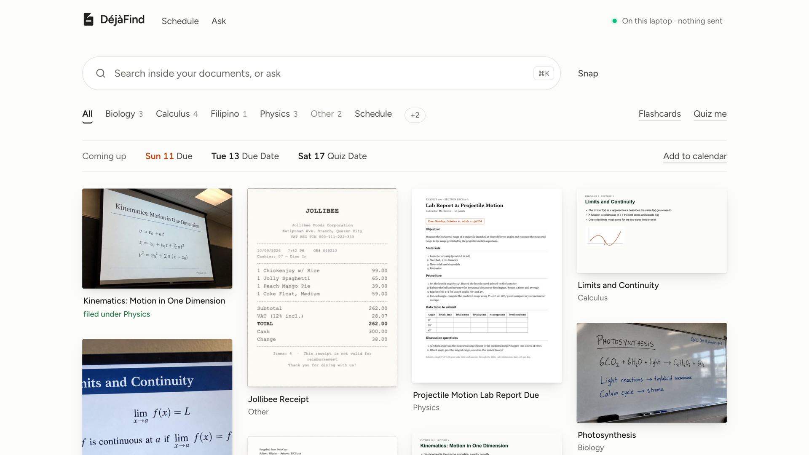
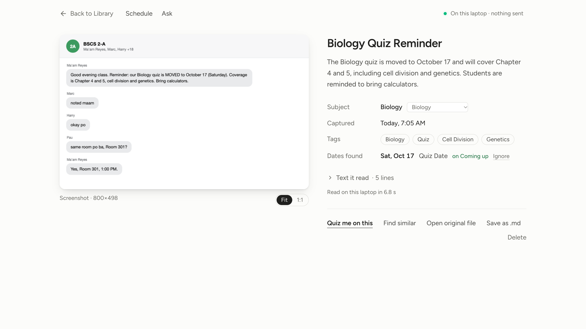
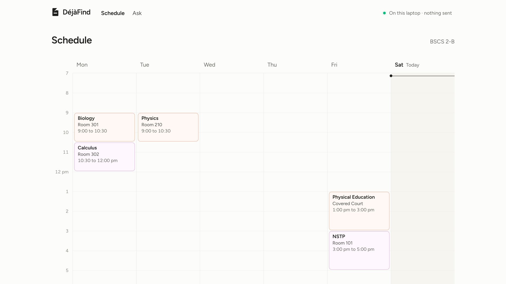
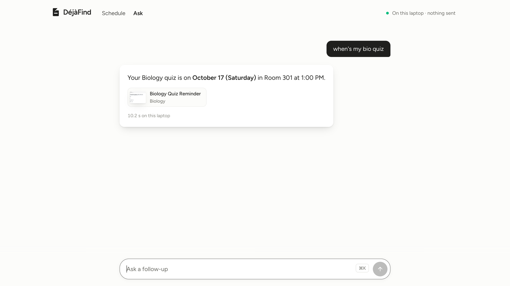

# DéjàFind

**The offline study brain.**

Snap your slides, screenshot your GC, drop your LMS files. DéjàFind watches your folders and, by itself, files every capture under its subject, puts every deadline on one timeline, and quizzes you from your own notes. Ask "when's my bio quiz?" and it answers from your captures and shows the one it came from. All on your own laptop, no internet.

Built by students, for students.

AppBuildersPH Hackathon 2026 entry. Theme: Local AI.

## Demo

- **53-second video:** [`video/dejafind-demo.mp4`](video/dejafind-demo.mp4), recorded from the real app on this laptop (no mockups), cut in HyperFrames, narrated, with captions burned in. The waits for the local models are cut for time, and the video marks each cut.
- **Alternative 48-second cut, "the night before":** [`video/dejafind-demo-v2.mp4`](video/dejafind-demo-v2.mp4), the same real footage and audio chain, cut on the music's beat; model waits are cut and labelled with their real duration.
- **82-second stage backup:** [`video/dejafind-backup.mp4`](video/dejafind-backup.mp4), the live demo script end to end, full screen, with captions.
- **Pitch deck:** open [`pitch/index.html`](pitch/index.html) in a browser. Works offline from `file://`. → or space for next, ← for back, F for fullscreen.

## Screenshots

| Library | Document view |
|---|---|
|  |  |
| **Schedule** | **Ask** |
|  |  |

## Why local AI

A website cannot watch your folders; it has to ask you to upload. Only software running on your machine can organize files as they arrive. It works with no signal and no data, costs nothing per file, and your class photos and personal screenshots never leave the device.

## Run it

Requires macOS or Linux, Node 20+, and [Ollama](https://ollama.com).

```bash
ollama pull qwen2.5vl:3b
ollama pull qwen3:4b
ollama pull nomic-embed-text
npm ci
npm run dev
```

Open http://localhost:3100. Turn Wi-Fi off; it keeps working.

### Try it in two minutes

The Library starts empty because the app only reads files it sees arrive. Thirteen synthetic sample files are in `data/samples/demo/` (a timetable, group-chat screenshots, slide photos, a whiteboard, a handout, a PDF, a receipt; see its README for what each one should produce). Load them one of three ways:

1. In the empty Library, click **Load the sample files**.
2. Or run `node scripts/seed.mjs --base http://localhost:3100` in a second terminal; it loads them in the demo order and prints what was read.
3. Or copy any of them into `data/watch/`, one at a time, and watch the tile land.

Then: click **Use it** on the schedule card, type `when's my bio quiz` in the search bar, open **Biology** and press **Quiz me**. Click the status dot top right to see the three models and the outbound request counter at 0. The first read after launch takes about 40 s while the vision model loads; after that, 8 to 20 s per file.

Tested on macOS (Apple silicon). Linux works too; the Lens tap (word boxes) uses Apple Vision and simply stays off elsewhere.

## What runs locally, what needs internet

- **Runs locally:** everything in the product. File watching, reading images and PDFs, summarizing, subject filing, date extraction, search, question answering, and the quiz all run on the laptop through Ollama.
- **Needs internet:** only the one-time model download through `ollama pull`. Nothing at runtime.

## Measured on this machine

Numbers below come from `node scripts/bench.mjs` run on Oct 10 2026 at 05:09 against a fresh production build (`next build && next start`) on this Apple M4 with 16 GB, nothing else using Ollama. Rerun it yourself: start the app with an empty `data/` folder, then `node scripts/bench.mjs --base http://localhost:3000`. The full output is in `docs/BENCH.md`.

| What | Time |
|---|---|
| First read after the server starts (model load included) | 39 s |
| Reading a screenshot, photo, or slide, warm (10 files) | 8.5 s to 20.8 s, average 15.7 s |
| Reading a one-page PDF (text model) | 39.7 s |
| Keyword search | 0.1 s |
| Question with a cited answer | 9.7 s to 14.1 s |
| Five-question quiz on a subject, generated on demand | 60.7 s |
| The same quiz when the app had already written it in the background (it does this 20 s after a subject gets a new document) | 1.5 s |
| Seven flashcards | 37.8 s |
| Reviewer sheet, ten lines | 44.1 s |
| Word boxes for the Lens tap (Apple Vision, first call compiles the helper) | 17.7 s |
| Outbound requests during the whole run | 0 |

Earlier runs on the same machine measured 5.4 s per read when the server had just read a similar file; the story pane's rehearsal run measured a 10.7 s median read, 12.4 s per cited answer, and 33 s per quiz. Expect that range. The first read after launch is always the slowest, so warm the app with one file before a demo.

## Disclosures

Keep this section current. Every model, framework, and library is listed the moment it is added.

**Models (all run locally via Ollama)**
- `qwen2.5vl:3b` (Qwen2.5-VL 3B Instruct, Qwen Research License: non-commercial research and evaluation use; the 7B checkpoint is the Apache 2.0 one, this entry is a 3B): reads images, returns text, title, summary, tags, dates.
- `qwen3:4b` (Qwen3 4B, Apache 2.0): text files, structured extraction, answers, quiz generation.
- `nomic-embed-text` (Nomic Embed v1.5, Apache 2.0): embeddings for semantic search.

**Frameworks and libraries**
- Next.js 16, React 19, TypeScript, Tailwind CSS 4
- UI: shadcn/ui (Base UI flavor) with the tweakcn "claude" theme preset, Magic UI `animated-list` (MIT), Kibo UI `status` (MIT), `motion`, `lucide-react`, `sonner`
- Fonts via Google Fonts: Fraunces, Figtree, JetBrains Mono (OFL)
- Ollama (local model server) and the `ollama` JS client
- `chokidar` (folder watching), `better-sqlite3` + `sqlite-vec` + SQLite FTS5 (storage and search), `pdf-parse` (PDF text), `chrono-node` (date cross-check)
- `sharp` (thumbnails, downscaling, image cleanup)
- `@techstark/opencv-js` (OpenCV compiled to WebAssembly, Apache 2.0): document edge detection and perspective warp for photographed slides and whiteboards, Node only
- Apple Vision framework (macOS, on-device OCR, no network): word boxes for the Lens tap, via `scripts/ocr-words.swift` compiled on first use with `swiftc`; the compiled binary is gitignored

**Cloud services and APIs:** none in the product. Next.js's own anonymous build telemetry is disabled on the demo machine with `npx next telemetry disable` so the outbound-request counter reads zero.

**Existing code and assets:** none. Scaffolded with `create-next-app` on Oct 10 2026 during the hackathon. Sample files in `data/samples/` are synthetic: most are rendered from HTML we wrote; five photos (`bio-mitosis-slide.jpg`, `whiteboard-photosynthesis.jpg`, `calc-longquiz-handout.jpg`, `physics-kinematics-photo.jpg`, `calc-limits-photo.jpg`) were generated with OpenAI Codex's image tool during the hackathon from text we wrote, so the demo has realistic camera photos without using anyone's real documents.

**AI development tools:** Claude Code (Anthropic) was used as a coding assistant. All code was written during the hackathon. The logo mark is a hand-drawn SVG based on a concept image generated with OpenAI Codex during the hackathon; no generated raster ships as a logo.

**Exact npm packages in `package.json`, for completeness:** `@base-ui/react`, `@tailwindcss/turbopack`, `@techstark/opencv-js`, `@types/better-sqlite3`, `@types/node`, `@types/react`, `@types/react-dom`, `better-sqlite3`, `chokidar`, `chrono-node`, `class-variance-authority`, `cmdk`, `cn`, `eslint`, `eslint-config-next`, `lucide-react`, `motion`, `next`, `next-themes`, `ollama`, `pdf-parse`, `radix-ui`, `react`, `react-dom`, `shadcn`, `sharp`, `sonner`, `sqlite-vec`, `tailwindcss`, `tw-animate-css`, `typescript`.

**Demo video and pitch deck tooling (not part of the app):** HyperFrames (HeyGen's open-source HTML-to-video CLI) composites and renders `video/dejafind-demo.mp4` and `video/dejafind-backup.mp4`; the compositions in `video/hf/` load GSAP 3 (GreenSock, free standard licence) at render time. `ffmpeg` cuts the recordings. Headless Google Chrome, driven over the DevTools protocol by the scripts in `video/tools/` (no npm dependencies), records the real app; its fake-camera input is a frame made from the synthetic `whiteboard-photosynthesis.jpg`. Figtree (OFL) is copied from the app's own `next/font` build into `pitch/fonts/` and `video/hf/assets/fonts/` so the deck and video need no network. Every document shown in the video and the deck is a synthetic sample from `data/samples/demo/`.

**Demo video sound (not part of the app):** the narration was generated with `edge-tts` (Microsoft's online neural text-to-speech, voice en-US-AndrewMultilingualNeural), used only to voice the promo video; the app makes no network calls. Music is "Newer Wave" by Kevin MacLeod (CC BY 4.0, credited in `docs/SUBMISSION.md`); sound effects are Kenney CC0 plus effects synthesised for the video.

## Team

See the submission form. Members are listed exactly as on the official AppBuildersPH participant list.
